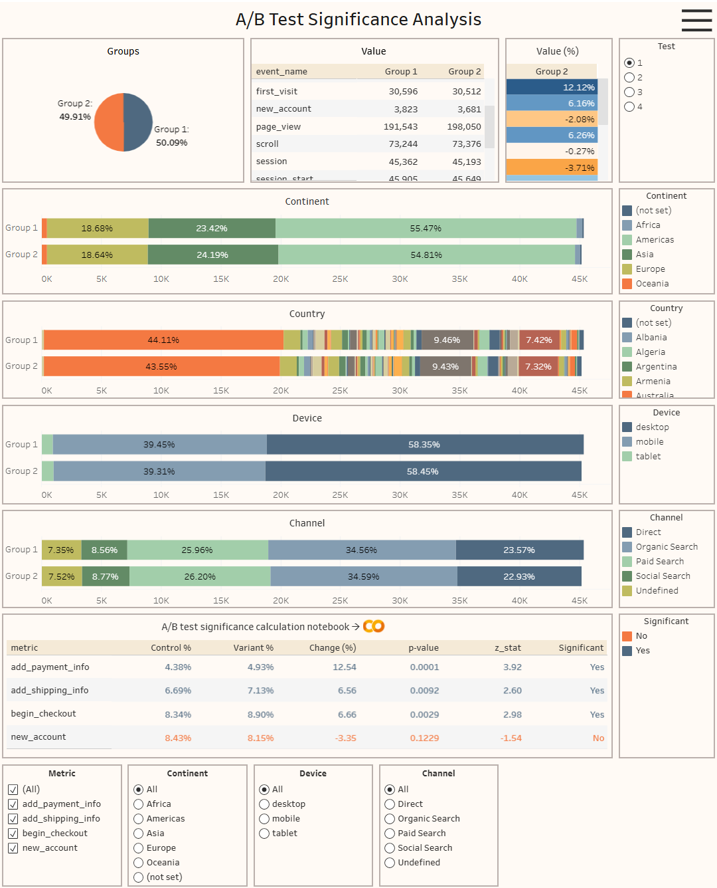

# A/B Test Significance Analysis

Python statistical analysis project built using Google Colab and Google BigQuery.

## Description

Analyzes A/B test performance by comparing conversion rates between control and variant groups, evaluating statistical significance using Z-tests across four key metrics, multiple tests, and segments.

## Dataset

`data-analytics-mate.DA`

## Analysis

- Control and variant groups
- A/B test performance
- Conversion rates
- Conversion rate differences
- Four A/B test metrics
- Statistical hypothesis testing
- Two-proportion Z-tests
- P-values and statistical significance
- Performance comparisons across tests and segments

## Tools

- Python
- SQL
- Pandas
- NumPy
- Matplotlib
- Seaborn
- SciPy
- Google BigQuery
- Google Colab
- Tableau Public

## Dashboard

[Open in Tableau Public](https://public.tableau.com/app/profile/volodymyr.tsapko/viz/ABTestSignificanceAnalysis_17925911138990/Dashboard)

## Notebook

[ab_test_significance_analysis.ipynb](ab_test_significance_analysis.ipynb)
